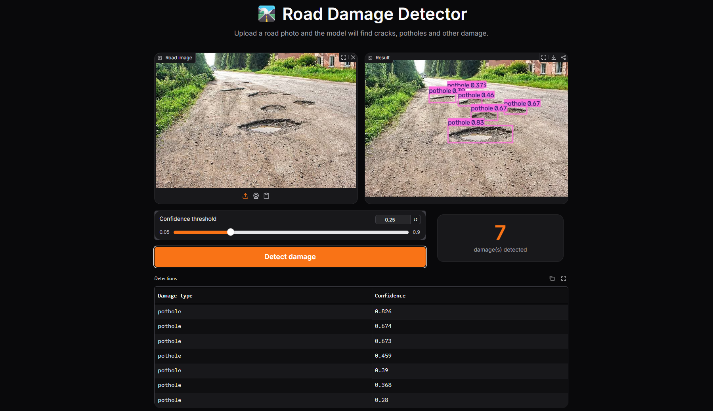
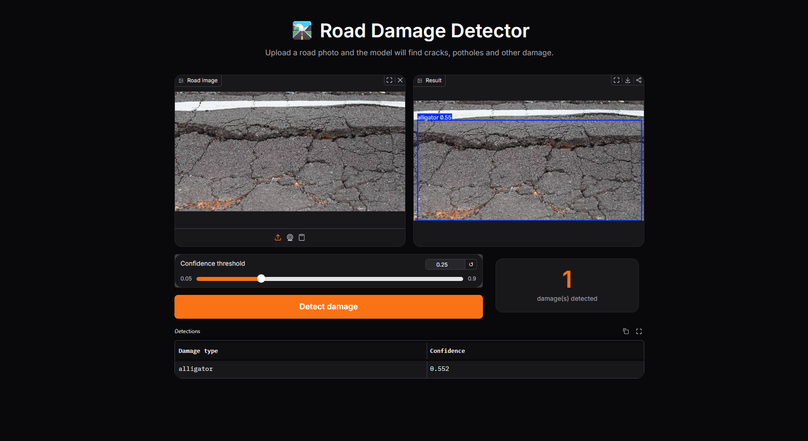
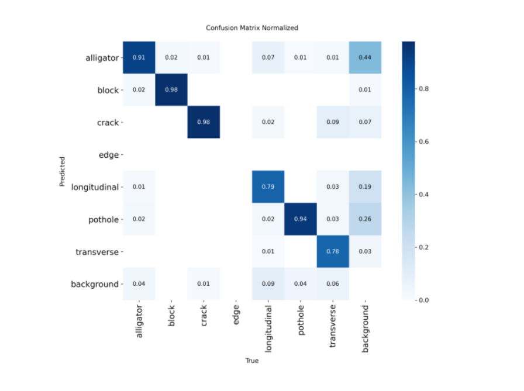

# 🛣️ Road Damage Detection with YOLO


An object detection system that finds and classifies **road damage** (potholes, cracks and more) in photos. Three YOLO versions (**YOLO26n, YOLO12n, YOLO11n**) are trained and compared, the best one is tuned, and the final model is deployed as an interactive **Gradio** web app.

> ⚠️ This is a student project and is not a certified road inspection tool.

---

## 🌐 Links

- 📓 **Training notebook on Kaggle:** [road-damage-object-detection](https://www.kaggle.com/code/abdelazizelshourbgy/road-damage-object-detection)
- 🚀 **Live demo:** [https://huggingface.co/spaces/Abd3laziz1/road-damage-detector](https://huggingface.co/spaces/Abd3laziz1/road-damage-detector)

## 📸 Demo

<!-- Put your screenshots in assets/ and keep the names below -->



---

## ✨ Features

- Detects **7 damage types** and draws a box around each one
- Adjustable confidence threshold
- Shows the number of detections and a table with the class and confidence of each box
- Small model (**about 5 MB**) that runs on CPU

## 🗂️ Dataset

[Road Damage dataset](https://universe.roboflow.com/trafficsignssafeway/road-damage-l1ju7) by TrafficSignsSafeway on Roboflow Universe (CC BY 4.0). It was forked, resized to **640×640** (stretch), with no augmentation.

- **6,757 images** and **20,619 boxes** (about 3.1 per image)
- Split: **4,730 train / 1,351 validation / 676 test**

| Class | Boxes | Share |
|---|---|---|
| pothole | 8,584 | 41.6% |
| alligator | 5,915 | 28.7% |
| longitudinal | 2,867 | 13.9% |
| crack | 2,116 | 10.3% |
| transverse | 677 | 3.3% |
| block | 438 | 2.1% |
| edge | 22 | 0.1% |

The classes are strongly imbalanced, and `edge` has no boxes in the test set.

---

## 📊 Results

### Comparison of three YOLO versions (test set)

All models were trained with the same settings: 20 epochs, image size 640, batch 16, Adam, learning rate 0.001.

| Model | mAP50 | mAP50-95 | Precision | Recall | Mean IoU | GPU FPS | CPU FPS | Size (MB) |
|---|---|---|---|---|---|---|---|---|
| **YOLO26n** | **0.590** | **0.357** | **0.630** | **0.561** | 0.758 | 79.5 | 13.1 | 5.20 |
| YOLO12n | 0.582 | 0.336 | 0.600 | 0.540 | 0.731 | 61.2 | 10.4 | 5.30 |
| YOLO11n | 0.555 | 0.332 | 0.619 | 0.511 | 0.780 | 86.3 | 13.3 | 5.25 |

- **YOLO26n** is the best overall (mAP, Precision, Recall) at a speed close to the fastest model.
- **YOLO11n** is the fastest and has the highest mean IoU, but the lowest recall.
- **YOLO12n** is the slowest and not better on any metric.
- Differences are small and each model was trained once, so the advantage of YOLO26n should be read as slight.

### Hyperparameter tuning (YOLO26n, validation set)

| Learning rate | Batch | Val mAP50 | Val mAP50-95 |
|---|---|---|---|
| **0.0005** | **16** | **0.398** | **0.229** |
| 0.002 | 16 | 0.394 | 0.226 |
| 0.002 | 8 | 0.371 | 0.207 |
| 0.0005 | 8 | 0.360 | 0.205 |

The tuned run was selected on validation mAP50-95 and is the deployed model. On the test set, tuning gave **no meaningful gain**:

| Stage | mAP50 | mAP50-95 | Precision | Recall |
|---|---|---|---|---|
| Baseline | 0.590 | 0.357 | 0.630 | 0.561 |
| Final (tuned) | 0.579 | 0.360 | 0.602 | 0.548 |

### Per-class results (final model, test set)

| Class | Precision | Recall | mAP50 | mAP50-95 |
|---|---|---|---|---|
| crack | 0.645 | 0.871 | 0.859 | 0.660 |
| block | 0.662 | 0.830 | 0.806 | 0.614 |
| pothole | 0.671 | 0.626 | 0.670 | 0.366 |
| transverse | 0.597 | 0.552 | 0.570 | 0.289 |
| alligator | 0.607 | 0.162 | 0.307 | 0.143 |
| longitudinal | 0.429 | 0.250 | 0.260 | 0.089 |

- Crack and block are detected best. Block reaches this with only 438 boxes.
- **Alligator and longitudinal are the weakest.** Alligator is the second most frequent class yet has the lowest recall, so class frequency alone does not explain the weak results. Possible causes (not verified) are large boxes with unclear boundaries, thin and long cracks, and images of very different sizes stretched to 640×640.



---

## 📁 Project structure

```
road-damage-detection/
├── app.py                  # Gradio app
├── best.pt                 # trained YOLO26n weights (about 5 MB)
├── road-damage.ipynb       # training, comparison and evaluation notebook
├── requirements.txt
├── assets/                 # screenshots and charts
├── LICENSE
└── README.md
```

## 🚀 Run locally

```bash
git clone https://github.com/AbdelazizElshourbgy-ui/road-damage-detection.git
cd road-damage-detection

python -m venv venv
venv\Scripts\activate        # Windows
# source venv/bin/activate   # macOS / Linux

pip install -r requirements.txt
python app.py
```

Open the local address printed in the terminal (usually `http://127.0.0.1:7860`) and upload a road photo.

**Tip:** raise the confidence threshold (for example to 0.25 or higher) to remove weak and overlapping boxes.

## 🔁 Reproduce the training

Open the notebook on Kaggle with a GPU, add your Roboflow API key as a Kaggle Secret named `ROBOFLOW_API_KEY`, and run all cells. A full run takes about 2.5 hours on a T4 GPU. **Never commit your API key.**

## ⚠️ Limitations

- Only nano models were trained, with a limited number of epochs, and each configuration was run once.
- Strong class imbalance. `edge` has only 22 boxes and is missing from the test set.
- Alligator and longitudinal cracks have low recall.
- Source images vary a lot in size and were stretched to 640×640, which can distort thin damage.
- The validation set scores lower than the test set for all models, so the two sets are probably not equally hard.

## 🔮 Future work

- Larger models (small or medium) and more epochs
- Class-balanced sampling or augmentation for rare classes
- Letterbox resizing instead of stretching
- Several runs with different seeds to measure variance

## 🛠️ Tech stack

Python · Ultralytics YOLO · PyTorch · Gradio · Pandas · Matplotlib · Roboflow · Kaggle

## 👤 Author

**Abdelaziz Elshourbgy**

GitHub: [@AbdelazizElshourbgy-ui](https://github.com/AbdelazizElshourbgy-ui) · LinkedIn: [Abdelaziz Elshourbgy](https://www.linkedin.com/in/abdelaziz-elshourbgy-b126a83a2/)

## 📄 License

Code released under the [MIT License](LICENSE). The dataset is by TrafficSignsSafeway on Roboflow Universe, licensed CC BY 4.0.
